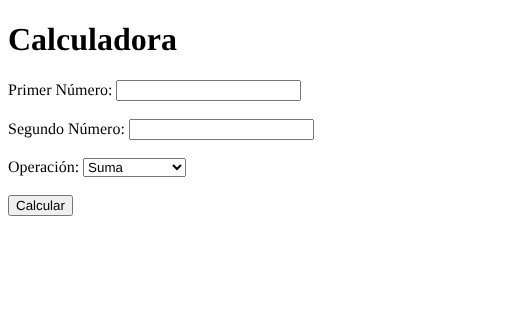
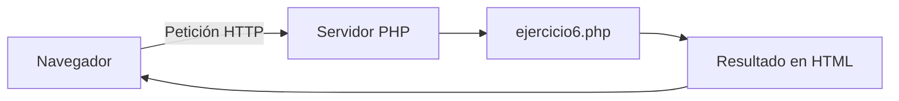

# Práctica 2: Ejercicios de PHP


Colección de **ejercicios básicos de PHP** (arrays, bucles, cadenas, fechas y formularios)
realizados en 2º de *DAW*.

> Documentación en Markdown: <https://docs.github.com/es/get-started/writing-on-github>

## Índice

- [Capturas](#capturas)
- [Ejercicios](#ejercicios)
- [Tecnologías](#tecnologías)
- [Instalación](#instalación)
- [Arquitectura](#arquitectura)
- [Tareas pendientes](#tareas-pendientes)
- [Avisos](#avisos)
- [Preguntas frecuentes](#preguntas-frecuentes)
- [Licencia](#licencia)

## Capturas

Imagen enlazada desde una URL externa:


Imagen almacenada en el propio repositorio (carpeta `images/`):



## Ejercicios

### Lista desordenada

- `aleatorios.php`: 10 números aleatorios únicos, mayor, menor y promedio.
- `cumpleanos.php`: días que faltan para cada cumpleaños.
  - Usa `date('z')` para obtener el día del año.
- `factorial.php`: factorial de un número leído por teclado.
- `temperaturas.php`: de Celsius a Fahrenheit y Kelvin.
- `vocales.php`: cuenta las vocales de una cadena.
- `formulario.html` y `ejercicio6.php`: calculadora con formulario.

### Lista ordenada

1. Descarga el proyecto.
2. Abre una terminal en la carpeta.
3. Ejecuta el script que quieras con `php aleatorios.php`.

### Énfasis de texto

Texto en *cursiva*, en **negrita** y ~~tachado~~.

### Enlace

Documentación oficial de [PHP](https://www.php.net).

### Cita

> Los programas deben escribirse para que los lean las personas.

### Tabla de ficheros

| Archivo          | Tipo       | Entrada    |
|:-----------------|:----------:|-----------:|
| `aleatorios.php` | Consola    | Ninguna    |
| `factorial.php`  | Consola    | Teclado    |
| `ejercicio6.php` | Web (POST) | Formulario |

### Código de ejemplo

```php
<?php
$numero = 5;
$resultado = 1;
for ($i = 1; $i <= $numero; $i++) {
    $resultado *= $i;
}
echo $resultado;
```

## Tecnologías

| Capa     | Tecnología |
|----------|------------|
| Backend  | PHP 8.2    |
| Frontend | HTML       |
| Docs     | Markdown   |

## Instalación

```bash
git clone https://github.com/monterodaw/practica2-php.git
cd practica2-php
php aleatorios.php
```

## Arquitectura

Funcionamiento de la calculadora web:



## Tareas pendientes

- [x] Crear los ejercicios de PHP
- [x] Documentar el proyecto con Markdown
- [ ] Validar los datos del formulario (división entre cero)
- [ ] Añadir pruebas automáticas

## Avisos

> [!NOTE]
> Los scripts de consola usan `readline()`, que requiere PHP en modo CLI.

> [!WARNING]
> `ejercicio6.php` no valida la entrada: no lo uses en producción[^1].

[^1]: Dividir entre cero provoca un error en PHP 8.

## Preguntas frecuentes

<details>
<summary>¿Cómo ejecuto un script de consola?</summary>

Usa `php nombre.php` desde la carpeta del proyecto.

</details>

<details>
<summary>¿Qué versión de PHP necesito?</summary>

PHP 8.2 o superior.

</details>

## Cambios y colaboración

- Historial de versiones: consulta el [CHANGELOG](CHANGELOG.md).
- Normas para colaborar: [CONTRIBUTING](CONTRIBUTING.md).

## Licencia

Este proyecto se distribuye bajo la licencia **MIT**. Ver [LICENSE](LICENSE).

**¿Por qué MIT?** Es una licencia permisiva y muy corta: permite usar, copiar,
modificar y vender el código con la única condición de mantener el aviso de
*copyright*. Al ser ejercicios de clase sin dependencias ni patentes, no hace
falta el copyleft de GPL v3 ni la cláusula de patentes de Apache 2.0.

## Autoría

Javier Montero Chaves - 2º DAW
